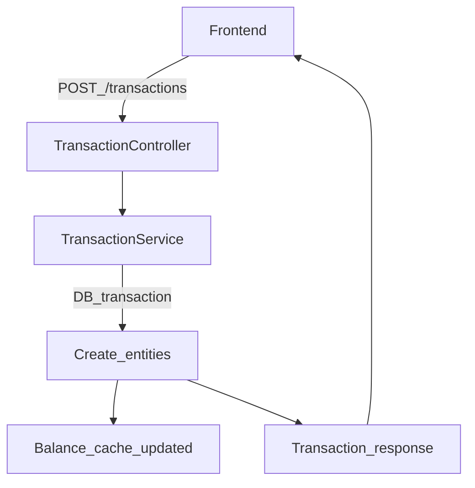

# Key Workflows

This chapter shows how SudoSOS behaves in practice. It does not try to document every endpoint; it explains the flows that keep the system correct.

**After reading this page, you should know** which entities and services are involved when money moves.

## Purchase (create a transaction)

**Trigger + actor**
- Member buys items (self-service) or a cashier enters the purchase (cashier mode).

**API surface**
- `POST /transactions` (create)
- `POST /transactions/validate` (validate without creating; used by some clients)
- `GET /transactions` and `GET /transactions/:id` (read)

**Entities touched**
- `Transaction`, `SubTransaction`, `SubTransactionRow`
- product/container/POS revisions referenced by rows and sub-transactions
- `Balance` cache (updated from transaction rows and transfers)

**Critical checks**
- product revisions exist and match the request
- container/POS configuration matches (what is available where)
- debt rules (`canGoIntoDebt` for the buyer)
- POS token restrictions for “lesser” POS tokens

**Who receives the money**
- Revenue is split by `SubTransaction`: the **container owner is the seller** for that part of the purchase.
  The POS owner and product creator are not used to decide who is paid.

**Side effects**
- receipts/notifications may be sent by subscribers after persistence

## Invoice

**Trigger + actor**
- Finance/admin groups eligible purchase rows into an invoice. Conceptually this is a **top-up** paid via bank transfer.

**API surface**
- `GET /invoices/eligible-transactions` (discover what can be invoiced)
- `POST /invoices` (create)
- `GET /invoices/:id` and `GET /invoices` (read)
- `GET /invoices/:id/pdf` (PDF)
- `PATCH /invoices/:id` (state changes, updates)
- `DELETE /invoices/:id` (delete/cancel invoice)

**Entities touched**
- `Invoice` (and invoice entries)
- `SubTransactionRow` links to invoices (to prevent double invoicing)
- an invoice transfer (void → user) that increases the user balance

**Critical checks**
- which rows are eligible (and for which user)
- linking/unlinking rows is consistent (no row belongs to multiple invoices)

**VAT note**
- VAT does not live on the invoice transfer. VAT is recorded via the underlying transactions and is reflected in seller-side settlement (seller payouts).

## Deposit (Stripe top-up)

**Trigger + actor**
- Member tops up their balance via Stripe.

**API surface**
- `POST /stripe/deposit` (create a Stripe payment intent; checks min/max top-up rules)
- `POST /stripe/webhook` (Stripe notifies the backend about payment intent updates)
- `GET /stripe/public` (frontend fetches Stripe public key and return URL)

**Entities touched**
- Stripe payment intent records (backend-owned representation)
- a top-up transfer (void → user) that credits the user when the payment succeeds
- balance cache (derived from transfers)

**Critical checks**
- webhook event authenticity (signature verification)
- event routing: only accept events intended for this service
- idempotency: the same Stripe event may be delivered multiple times

## Terminal Payment (Stripe physical payment)
**Trigger +actor**
- Customer wants to perform an (anonymous) transaction and pay for it directly.

**API surface**
- `POST /terminal-payments` (create transaction to be paid, either anonymous (fromUser is POS) or by existing user)
- `POST /terminal-payments/{id}/process` (assign terminal payment to Stripe Terminal Reader and start physical transaction)
- `GET /terminal-payments/terminals` (get all Stripe Terminal Readers)

**Entities touched**
- `TerminalPayment`
- Everything from `Purchase (create a transaction)`
- Everything from `Deposit (Stripe top-up)`

**Critical checks**
- Amount is fixed at creation. When transaction needs to be edited, a new TerminalPayment must be created.
- Terminal can only process one TerminalPayment at a time.

**Simplified flow**
1. Temporary transaction is created (as if you are creating an actual transaction).
2. Balance is topped up with the amount to be paid for that transaction.
3. Temporary transaction is transformed into an actual transaction. Temporary transaction is removed.

## Tab (group pays at the end)
**Trigger +actor**
- A group (for example an external party) wants to order during an event and pay everything at once with a card on a Stripe Terminal.

**API surface**
- `POST /tabs` (open a tab with a name, contact name and contact email)
- `GET /tabs`, `GET /tabs/{id}`, `PATCH /tabs/{id}`, `DELETE /tabs/{id}` (list, read, edit contact details, cancel an empty tab)
- `POST /tabs/{id}/payment` (charge the outstanding amount on a Stripe Terminal Reader), `DELETE /tabs/{id}/payment` (cancel it)
- `GET /tabs/{id}/receipt`, `POST /tabs/{id}/receipt/send` (receipt PDF, resend the receipt email)
- `POST /tabs/{id}/convert-to-invoice-account` (group did not pay: bill it with an invoice instead)

**Entities touched**
- `Tab`, `TabPaymentAttempt`, `TabReceiptPdf`, `StripeDeposit`
- A `User` of type `TAB`, which the purchases are made on
- Everything from `Purchase (create a transaction)` and `Deposit (Stripe top-up)`

**Critical checks**
- Purchases can only be added while the tab is `OPEN`. While a payment is in progress (`LOCKED`) and after it is `PAID`, transactions on the tab cannot be created, edited or deleted (`TransactionService.verifyTransaction`, `TransactionService.isOnLockedTab`). Once the tab is `PAID`, its transactions count as paid by card terminal, like a direct terminal payment: they report `paidByTerminal: true` and an edit or delete gives the same 409 (`TransactionService.isPaidByTerminal`).
- The amount charged is the negated balance of the tab user at the moment the payment starts. Starting a payment and selling to, editing or deleting a purchase on the tab all lock the `Tab` row, so a change is either in that amount or refused (`TabService.startPayment`, `TransactionService.createTransaction`, `updateTransaction`, `deleteTransaction`).
- A payment only starts on a reader that is not busy. The reader is told to collect only after the payment is recorded, in a transaction that holds the tab lock (`TabService.collectOnTerminal`).
- A successful payment always credits the tab user, even if the tab is no longer `LOCKED`: the card was charged. A tab that was already paid, invoiced or cancelled is left as it is and an error is logged, so the credit can be refunded by hand (`TabService.settlePaidIntent`).
- `TAB` users are managed through `/tabs` only: `POST /users`, `PATCH /users/{id}` and `DELETE /users/{id}` refuse them. Like `POINT_OF_SALE` users, they are left out of `GET /users` and its search unless `type=TAB` is passed; a lookup by id still finds them (`UserService.getOptions`, `UserService.getUsers`).
- The receipt is only emailed after the webhook's database transaction has committed (`StripeWebhookController`).
- The payment is a `StripeDeposit`, so it is booked under Deposits like any Stripe top-up. The purchases are ordinary transactions and count in the sellers' sales. The receipt is a simplified invoice, like a till receipt: it shows the purchases and the VAT per rate, with the seller and its VAT number in the footer, but no buyer name or address (`createTabReceiptPdf`). Only converting the tab creates a full invoice.

**Simplified flow**
1. The tab and its `TAB` user are created. The point of sale sells to the user like to any buyer; its balance goes negative.
2. Paying the tab locks it and creates a `StripeDeposit` for the outstanding amount, whose payment intent is sent to the reader.
3. On `payment_intent.succeeded`, the deposit's void->user transfer brings the balance to zero, the tab becomes `PAID` and the tab user is deactivated. On `payment_intent.payment_failed` (for example a declined card) or `payment_intent.canceled`, the tab is `OPEN` again and can be paid with a new attempt.
4. The receipt PDF (a simplified invoice with all purchases) is stored and emailed to the contact person.
5. If the group does not pay, the tab can be converted: the tab user becomes an `INVOICE` user and is billed with the regular invoice flow. Converting asks for no details; the invoice account gets no default address, so the address is entered when the invoice is created (`TabService.convertToInvoiceAccount`).

## Payment request (shareable payment link)

**Trigger + actor**
- Treasurer (or a user for themself) creates a fixed-amount top-up request with an expiry. The recipient opens a share link (no login), pays via Stripe, and the money is credited to the linked user's balance.

**API surface**
- `POST /payment-requests` (create; admin can create for anyone, regular users only for themselves)
- `GET /payment-requests` (admin only: list all)
- `GET /users/:id/payment-requests` (admin for any user, regular users only for themselves)
- `GET /payment-requests/:id` (read a single request; admin sees all, user sees own)
- `POST /payment-requests/:id/cancel` (cancel a PENDING request)
- `POST /payment-requests/:id/start` (authenticated: start a Stripe session)
- `POST /payment-requests/:id/mark-fulfilled` (admin escape hatch for out-of-band payment)
- `GET /payment-requests-public/:id` (unauthenticated: fetch a trimmed view via share link)
- `POST /payment-requests-public/:id/start` (unauthenticated: start a Stripe session via share link)

**Entities touched**
- `PaymentRequest` (UUID pk, immutable amount, derived status)
- `PaymentRequestAttempt` (join table) links a `PaymentRequest` to each `StripePaymentIntent` it spawned — one request can have many intents (retries)
- on success: the standard Stripe deposit `Transfer` (void → user) already created by the deposit flow also settles the payment request

**Lifecycle (derived status)**
- `PENDING` → `PAID` when a linked Stripe intent succeeds.
- `PENDING` → `CANCELLED` when an authorized user cancels.
- `PENDING` → `EXPIRED` when `expiresAt` passes without payment.
- Status is derived from `paidAt` / `cancelledAt` / `expiresAt`; precedence is `PAID` > `CANCELLED` > `EXPIRED` > `PENDING`.

**Critical checks**
- amount is fixed at creation — a corrected amount means cancelling and creating a fresh request
- `startPayment` rejects non-`PENDING` requests
- the Stripe webhook flow idempotently calls `markPaid`: already-paid requests are left unchanged, cancelled requests refuse to flip, and expired-but-settled requests still become `PAID` (the money arrived, the clock is secondary)

**Invoices vs. payment requests**
- Invoices create their own credit transfer on behalf of the user (a "paper-trail top-up").
- Payment requests do not pre-create a credit transfer — the Stripe deposit is the single settlement event. A future "invoice via payment link" flow will compose by leaving the settlement to the payment request.

## Payout request (withdraw balance)

**Trigger + actor**
- Member requests a payout of part of their balance; admin approves and processes it.

**API surface**
- `POST /payoutrequests` (create request)
- `POST /payoutrequests/:id/status` (cancel, approve, process, etc.)
- `GET /payoutrequests` and `GET /payoutrequests/:id` (read)
- `GET /payoutrequests/:id/pdf` (PDF)

**Entities touched**
- `PayoutRequest` and `PayoutRequestStatus` records
- payout transfers (user → void) that move money out of the user account

**Critical checks**
- user has sufficient balance at request time and at approval time
- only admins can move a request to non-cancel states
- only the requesting user can cancel their own request

## Fine round (debt warnings and fines)

**Trigger + actor**
- An admin with the `create` and `notify` permissions on `Fine` runs a fine round from the dashboard (Financial → Debtors), usually once a week. The debtor overview lists all users in debt. The "Start fine round" button opens a stepper for the dates, the users to fine, the users to warn and a confirmation.

**Flow**
- The admin picks a **measurement date** (usually now) and the **previous measurement date** (defaults to when the last `FineHandoutEvent` was created).
- `A`: users at or below -5 EUR on the measurement date (`GET /fines/eligible` with one reference date).
- `F`: users at or below -5 EUR on both dates (`GET /fines/eligible` with both reference dates). These users are fined.
- `W = A \ F`: users in debt now, but not at the previous measurement. These users only get a warning.
- The dashboard first calls `POST /fines/handout` for `F`, then `POST /fines/notify` for `W`. If the handout fails, no warnings are sent.
- The handout is called even when `F` is empty. The empty `FineHandoutEvent` records the measurement date, so the next round compares against this round and not an older one.

**Emails**
- Users in `F` get one `UserGotFined` email. It also says they will be fined again if they are still in debt at the next measurement.
- Users in `W` get one `UserWillGetFined` email.
- Nobody gets both emails in the same round.

**Entities touched**
- `FineHandoutEvent`, `Fine`, `UserFineGroup`
- fine transfers (user → void)

**Critical checks**
- the fine amount is based on the balance on the first reference date (the measurement date), capped at 5 EUR
- `POST /fines/handout` does not re-check eligibility: every listed user gets a `Fine`, possibly of 0 EUR

## Next pages

- **[System Architecture](/general/3-system-architecture)**
- **[External Integrations](/general/4-external-integrations)**
- **[Understanding the Codebase](/general/5-understanding-codebase)**
